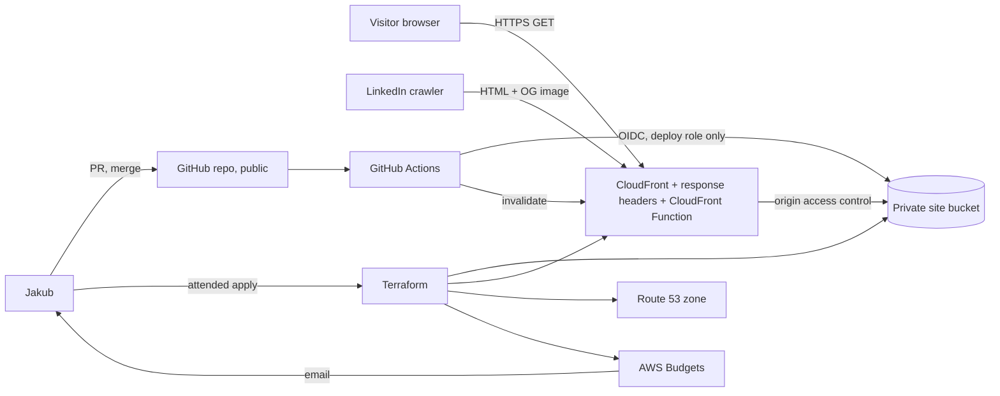
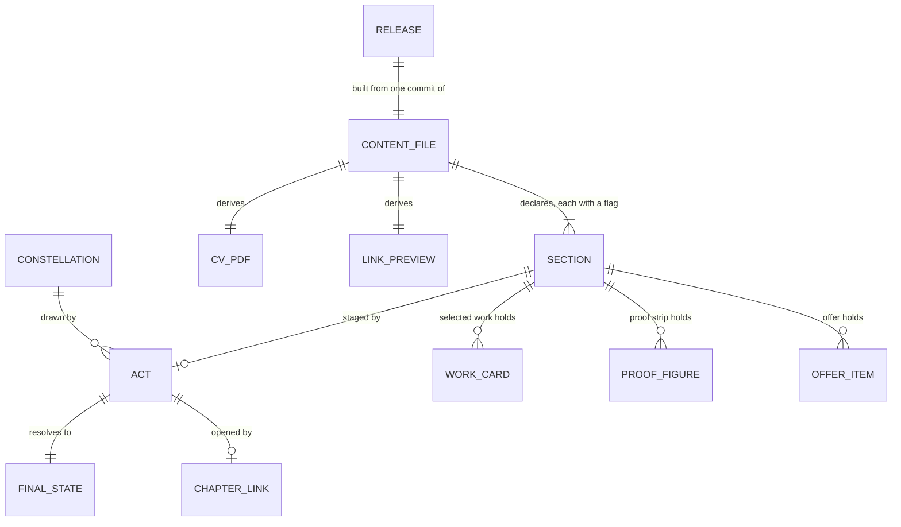

# Architecture

> Direction doc: every ticket whose tags appear in the xpm disciplines file
> reads this file and writes a `## Architecture` spec section against it.
> Hard cap 150 lines (`xpm check_architecture_doc.sh`). Decisions
> live in ADRs; this file links them and never restates them. Owned by the
> `xpm-architect` skill - re-run it rather than hand-editing a decision.

## System context

The trust boundary is the merge to main: only merged commits become a release. The page makes
no request to another origin at runtime; outbound links (email, LinkedIn, GitHub, credential
issuer) are plain navigation. Nothing is scheduled; the only alerts are the budget email and
GitHub's failed-run email.

## Module map

Two deployable units (ADR-0001) plus repo-level CI under `.github/`.

**web** (`apps/web`, Astro, static output only):
- `content` - the content file per language (`content/en.yaml`) and its schema; the only module
  that knows the file's shape. Everything else reads typed content from it.
- `sections` - one Astro component per section, rendering final states as plain HTML and CSS;
  a section renders only while its flag is on.
- `design` - tokens (colour, type, spacing, radius, easing, duration) as CSS custom properties,
  light and dark, and the core glass card, pill and button styles.
- `motion` - the one scroll timeline engine: CSS scroll-driven animation, the observer fallback,
  the reduced variant switch (reduced motion, low power, frame budget) and chapter links.
- `graph` - the constellation renderer (Canvas 2D), driven by a progress value from `motion`.
- `gate` - the Act 1 gate head script (same origin, under 1 KB).
- `head` - title, meta, canonical, Open Graph and Person JSON-LD built from `content`.
- `print` - the `/cv` and `/og` routes and the build step that renders them to PDF and PNG.

Dependency rule: `sections`, `head` and `print` read `content` and `design`; `motion` and `graph`
read only `design` tokens and the DOM the sections emit (data attributes), never `content`; no
module imports a section. Scripts are progressive enhancement over complete HTML.

**infra** (`infra`, Terraform, plain aws stack):
- `bootstrap/` - the state bucket (local state, applied once).
- `environments/prod/` - the one root: providers (eu-central-1, us-east-1 for ACM), backend,
  module calls.
- `modules/site-hosting` - bucket, OAC, distribution, headers policy, CloudFront Function (404,
  www to apex), certificate, records in the existing zone.
- `modules/deploy-role` - the GitHub OIDC provider and the site-deploy role.
- `modules/cost-guard` - the 2 USD budget and its email notifications.
- `policies/` - Checkov custom policies (banned resources, logging off, budget present).

Dependency rule: modules never read each other's state; `environments/prod` wires outputs to
inputs. CI never holds credentials for these roots (ADR-0010).

**.github** - one `ci.yml`: `web` (install from the lockfile with scripts off, lint, typecheck,
unit, build, Playwright, Lighthouse, budgets; uploads the release artifact), `infra` (fmt,
validate, tflint, Checkov), `repo` (pre-commit, secret scan, denylist, action pins, dash check),
`deploy` (main only, needs `web`, the only job with `id-token: write`, no install, inert until
the deploy role variable is set), and `ci-ok`, the one required check.

## Domain model

The content file is the system of record; the page, the link preview and the CV PDF are derived
and rebuilt on every release. Work cards obey the traceability rule; the denylist is checked
against every change. There is no visitor data: no cookies, no logs, no forms. The only client
storage is a session flag that Act 1 has played.

## Walking skeleton

Trigger: a pull request that edits the headline in `content/en.yaml`.

1. `content` validates the file against its schema; a bad value fails the build readably.
2. Astro renders the hero and footer sections to static HTML with design tokens, the
   "How I deliver" flag off and absent from the output.
3. The `web` job runs Vitest and a Playwright spec against the built output: the new headline
   is in the first HTML response and readable with JavaScript off; no request leaves the origin.
4. `infra`: fmt, validate and tflint pass on an empty `environments/prod` root with no cloud
   credentials; `repo` checks pass; `ci-ok` reports green on the PR.
5. On merge, `web` runs again on main (ADR-0016) and `deploy` is skipped cleanly because the
   deploy role variable is not set yet (NFR-022); after Jakub's attended first apply, the same
   job publishes the release and the headline is served from the live domain.

Locally, `mise run web:dev` serves the same page at http://localhost:4321.

## Decisions

- [0001 - Two components: web and infra](adr/0001-two-components-web-and-infra.md): static site plus Terraform hosting.
- [0002 - Astro static site](adr/0002-astro-static-site-framework.md): Astro, TypeScript, CSS custom properties.
- [0003 - YAML content file with Zod](adr/0003-yaml-content-file-with-zod-schema.md): one file per language.
- [0004 - Same-origin Act 1 gate](adr/0004-same-origin-act-1-gate-script.md): CSP stays script-src 'self'.
- [0005 - 50 KB JavaScript budget](adr/0005-javascript-budget-50kb.md): at most 1 KB render-blocking.
- [0006 - Low-power thresholds](adr/0006-low-power-thresholds-and-frame-budget.md): when the reduced variant starts.
- [0007 - Playwright renders PDF and OG image](adr/0007-playwright-renders-cv-pdf-and-og-image.md): from the same templates.
- [0008 - Fresh hosting Terraform](adr/0008-fresh-hosting-terraform.md): the 2021 module is retired.
- [0009 - S3 state with native locking](adr/0009-s3-state-backend-native-locking.md): bootstrap stack.
- [0010 - Attended Terraform applies](adr/0010-attended-terraform-applies.md): CI holds only the deploy role.
- [0011 - Never delete hashed assets](adr/0011-never-delete-hashed-assets.md): old HTML keeps working.
- [0012 - Failure email from GitHub](adr/0012-github-actions-failure-email.md): no extra permission.
- [0013 - Denylist in a secret, fail closed](adr/0013-client-name-denylist-secret-fail-closed.md): never printed.
- [0014 - Check toolchain](adr/0014-automated-check-toolchain.md): Vitest, Playwright, axe, Lighthouse CI, tflint, Checkov.
- [0015 - design-system tag](adr/0015-design-system-capability-tag.md): EN-005 provides it.
- [0016 - Main regression job](adr/0016-main-regression-job-ci-web.md): the `web` job of ci.yml.
